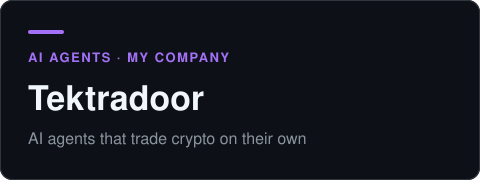
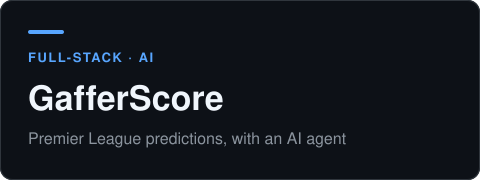
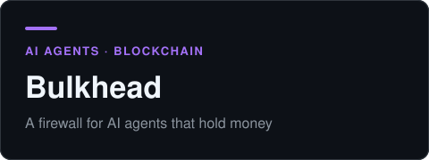
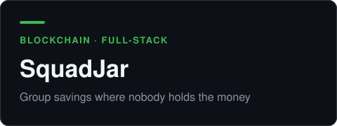

  

I'm a full-stack engineer. I build products end to end, from the interface to the API and the database, and much of my recent work puts blockchain and AI agents inside real apps.

Open to full-stack, blockchain, and AI engineering roles. [Get in touch](#contact).

<table>
  <tr>
    <th align="left" width="33%">🌐 Full-stack apps</th>
    <th align="left" width="33%">⛓️ Blockchain</th>
    <th align="left" width="33%">🤖 AI agents</th>
  </tr>
  <tr valign="top">
    <td>Web apps with auth, APIs, and real users.  React · Next.js · NestJS · GraphQL · FastAPI · Supabase · PostgreSQL</td>
    <td>Smart contracts and the apps people use them through.  Solidity · Monad · Solana · NEAR</td>
    <td>Agents that trade, predict, and write code, plus the checks that keep them honest.  Python · LLM APIs · CatBoost</td>
  </tr>
</table>

## Featured work

<table>
  <tr valign="top">
    <td width="50%">
       
      <b>Tektradoor</b> · my company 
      AI agents that trade crypto on their own. They choose when to trade, sit out when the market isn't worth it, and manage each trade from entry to exit. Every strategy is written down and hashed before it's tested, so results can't be tuned after the fact. 
      Python · trading agents · backtesting 
      <a href="https://github.com/Haikeysgit/tektradoor-judge">Test rig (code)</a>
    </td>
    <td width="50%">
       
      <b>GafferScore</b> 
      A Premier League prediction game. Fans predict results and exact scores, earn points, and climb a leaderboard. An AI prediction agent, built on Poisson and CatBoost models, analyses every fixture. 
      Next.js · Supabase · TypeScript · Python 
      <a href="https://gafferscore.xyz">Live</a> · <a href="https://github.com/Haikeysgit/gafferscore">Code</a> · <a href="https://github.com/Haikeysgit/gaffer-engine">Prediction engine</a>
    </td>
  </tr>
  <tr valign="top">
    <td width="50%">
       
      <b>Bulkhead</b> · in progress 
      A firewall and contract-enforced spending cap for AI agents that hold money. In its live arena, three agents guard real BTC and USDC in a NEAR vault while attackers try to talk them into paying out. Every attack improves the firewall. 
      NEAR · AI agents · prompt-injection defence 
      🏆 NEAR Hackathon 2026 · with <a href="https://github.com/faroukobayanju">Farouk</a>
    </td>
    <td width="50%">
       
      <b>SquadJar</b> 
      Ajo (rotating group savings) without a treasurer. Everyone pays in, each payout lands on schedule, and a smart contract holds the money instead of one person. 
      Monad · Solidity · Next.js 
      🏆 Monad Metropolis · with <a href="https://github.com/faroukobayanju">Farouk</a> 
      <a href="https://squadjar.vercel.app">Live</a> · <a href="https://github.com/faroukobayanju/squadjar">Code</a>
    </td>
  </tr>
</table>

## More projects

| Project | What it does | Built with |
|---|---|---|
| **[Kedge](https://github.com/faroukobayanju/kedge)** | Supervises unattended coding agents. Catches skipped tests and false "all green" claims, rolls back, and retries. 🏆 neatHack 2026 | Python · AI agents |
| **[Flux](https://github.com/Haikeysgit/flux)** | Finds abandoned Solana accounts sponsored through Kora and safely reclaims the SOL locked in them. | TypeScript · Solana |
| **[SmartBursar](https://github.com/Haikeysgit/smartbursar)** | School fee tracking over WhatsApp, with receipt OCR and an admin dashboard. | Python · FastAPI · LLMs |
| **[Chog Buddy](https://github.com/chog-buddy-team/chog-buddy)** · [live](https://chogbuddy.vercel.app) | Turns a Chog NFT into a desktop pet that talks, keeps a diary, and grows an onchain Soul. 🏆 Chogathon 2026 | Electron · Monad |
| **[Bookkeeper](https://github.com/Haikeysgit/bookkeeper)** · [live](https://bookkeeper-seven.vercel.app) | Full-stack book management app with Auth0 login and a GraphQL API. | React · NestJS · GraphQL · Auth0 |

All repositories: [github.com/Haikeysgit?tab=repositories](https://github.com/Haikeysgit?tab=repositories)

## Contact

